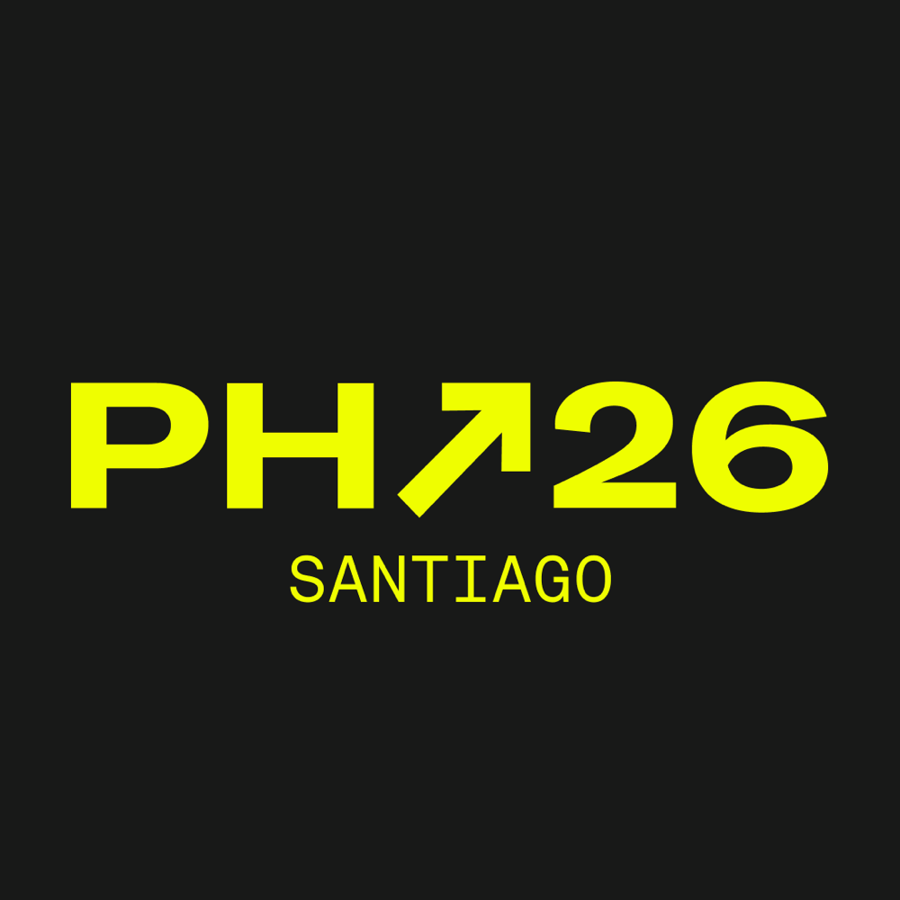

# Sub50

## What Sub50 is

Sub50 is an open, interactive blackout simulator for the Chilean national power grid (SEN) that runs in the browser. The user cuts a transmission line or a plant on the map. The app shows which zones lose power, how many people are affected and why, as a chain of events in plain language. The name refers to grid frequency falling below 50 Hz. Product, scope and limits: [`docs/idea.md`](docs/idea.md).

The main objective is to estimate the consequences of cyberattacks on this infrastructure. Sub50 models the effect of an attack (plants or lines disconnected, defences disabled), never how the attack is done. The guardrails are in [`docs/cyber.md`](docs/cyber.md) section 8.

## What it simulates

- The cascade that follows a line cut on a 188-bus reduction of the SEN (PyPSA-CL data): DC power flow, overload trips, islands, island frequency with automatic load shedding (EDAC), and people without supply ([`docs/engine.md`](docs/engine.md)).
- A strategic theatre on the same network: events, defensive actions and agents that keep a mission under adverse conditions ([`docs/strategy.md`](docs/strategy.md), [`docs/agents.md`](docs/agents.md)).
- Shared sessions, an MCP server and an in-app assistant that drive the same engine ([`docs/sessions-api.md`](docs/sessions-api.md), [`docs/mcp.md`](docs/mcp.md), [`docs/assistant.md`](docs/assistant.md)).

## Run it

Needs only Docker with Compose:

```bash
docker compose up --build
```

The web app is at http://localhost:5173 and the API at http://localhost:8000 (`/docs`). Ports, the Mapbox token and the optional LLM are in [`docs/docker.md`](docs/docker.md).

## What is validated, and what is not

- Validation cases V1-V10 are tests in `backend/tests/validation/`. They run on the 13-area engine (`backend/src/cascadasen/domain/simulation`), which serves `POST /api/v1/simulate`.
- The 188-bus engine that serves the map, the sessions and the theatre is checked only against the V1 flow distribution (`backend/tests/unit/test_cascade.py`).
- V6 and V9 are skipped because their reference data is not in the repo (`test_engine_cases.py`).
- The cases show that the engine reproduces published figures of the 25 February 2025 blackout and of the grid operator's studies. They do not show that it predicts future events. V1 and V3a are calibration cases (`docs/plan.md` section 5), so passing them shows the fit, not accuracy.

See [`docs/engine.md`](docs/engine.md) and [`docs/plan.md`](docs/plan.md) section 5.

## Checks (CI)

CI runs backend pytest with a coverage floor, a mypy baseline (non-blocking), web tsc/vitest/build, and the deploy needs them. Lint (ruff) and the `CHANGELOG.md` check run on every pull request. The workflows are in `.github/workflows/`.

## Names

| Name | Where |
|---|---|
| Sub50 | The product |
| `cascadasen` | The Python package and its commands (`cascadasen-build`, `cascadasen-cache`, ...), the earlier product name |
| `platanus-hack-26-cl-team-9` | This repository |

## Repository map

| Path | Content |
|---|---|
| `backend/` | Python package `cascadasen` (uv): FastAPI API, the two engines, the strategic theatre, MCP server, tests ([`backend/README.md`](backend/README.md)) |
| `web/` | Vite + React + TypeScript app with deck.gl and an optional Mapbox basemap ([`web/README.md`](web/README.md)) |
| `data/` | Public-source scripts (`scripts/`), committed processed data (`processed/`), scenarios |
| `docs/` | Documentation, listed below |
| `infrastructure/` | Terraform and deploy script for AWS ([`docs/infrastructure.md`](docs/infrastructure.md)) |
| `scripts/` | `lint.sh` and git hooks |
| `docker-compose.yml` | Local run |

## Documentation

| Doc | Topic |
|---|---|
| [`docs/idea.md`](docs/idea.md) | Product, scope, limits, risks |
| [`docs/cyber.md`](docs/cyber.md) | Main objective (cyberattack consequences) and guardrails |
| [`docs/stack.md`](docs/stack.md) | Decisions, simulation model, data contracts, API |
| [`docs/architecture.md`](docs/architecture.md) | How the system is built |
| [`docs/adr/`](docs/adr/README.md) | Architecture decision records |
| [`docs/plan.md`](docs/plan.md) | Phases, validation cases, open decisions |
| [`docs/sessions-api.md`](docs/sessions-api.md) | Shared sessions and the agent API |
| [`docs/mcp.md`](docs/mcp.md) | MCP server |
| [`docs/assistant.md`](docs/assistant.md) | In-app assistant |
| [`docs/regional.md`](docs/regional.md) | Other countries' networks |

Read order for contributors and agents: [`AGENTS.md`](AGENTS.md).

## Hackathon metadata

team-9, Platanus Hack 26: Santiago ft. Buk Project.

**Current project logo:** project-logo.png



Track: 🌐 Simulations

team-9

- Valentina Honorato ([@ValHonom](https://github.com/ValHonom))
- Ricardo Olalquiaga ([@Icksir](https://github.com/Icksir))
- Alonso Utreras Miranda ([@AlasAltum](https://github.com/AlasAltum))
- Ignacio Montenegro ([@ignaciomontenegroc](https://github.com/ignaciomontenegroc))
- Felipe Javier Sanhueza Celis ([@Sanhuezafce](https://github.com/Sanhuezafce))

Deploy URL and project metadata: `platanus-hack-project.jsonc`.
