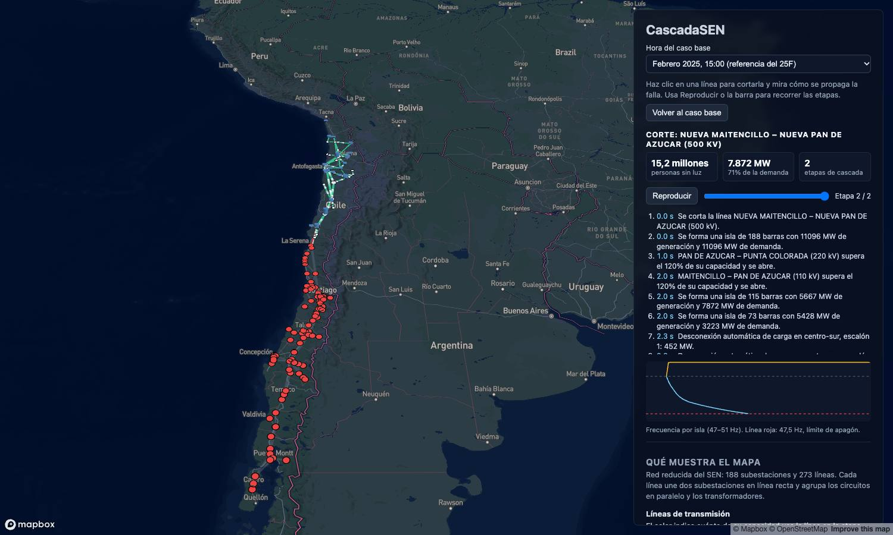

# Mapa 3: cascade viewer

Mapa 3 is the main map of the app (`/`, also `?mapa=3`). Mapas 1 and 2 (`?mapa=1`, `?mapa=2`) are deprecated and kept as reference. Mapa 3 shows what happens to Chile's SEN when you cut a transmission line. You click a line, the engine (`docs/engine.md`) computes the cascade, and the map replays it stage by stage: lines that overload and open, islands that form, substations that go dark, and the frequency of each island.

UI strings are Spanish. This document is English. Every claim is tagged EVIDENCE (read from code, data or engine output) or ASSUMPTION (a modelling choice, not verified against the real system).


## 1. Actors in the network

This is the reference list for future work. Each actor has: what it is in our data, what role it plays in the cascade, how the map draws it, and where it lives in the code. "Modelled" means the engine computes something with it.

### 1.1 Summary table

| # | Actor | Modelled | Role in the cascade | Drawn on the map |
|---|---|---|---|---|
| A1 | Substation (bus) | Yes | Node where generation, demand and lines meet. Becomes dark when its island collapses. | Circle. White = energised, red = dark, bigger = 500 kV |
| A2 | Transmission line | Yes | Carries power between two substations. Opens when it exceeds 120% of capacity, or when you cut it. | Line. Colour = loading, width = kV |
| A3 | Synchronous generator | Yes (aggregated per bus) | Supplies MW, supplies inertia (slows frequency change) and primary reserve. | Not drawn |
| A4 | Non-synchronous generator (solar, wind, CSP) | Yes (aggregated per bus) | Supplies MW, no inertia, no reserve. Is curtailed when frequency rises above 50.2 Hz. | Not drawn |
| A5 | Demand (load) | Yes | Consumes MW. Falls slightly with frequency. Is the thing that gets shed. People in the dark are computed from it. | Blue rectangular bar |
| A6 | Overload protection | Yes (simplified) | Opens the most overloaded line(s) each stage. | Line turns grey and thin ("open") |
| A7 | EDAC (under-frequency load shedding) | Yes | Disconnects demand in steps when island frequency falls. | Events list, frequency chart, shorter bars |
| A8 | Island | Yes (emergent) | A group of substations still connected to each other after cuts. Has its own frequency. Survives or blacks out as a whole. | Colour of its frequency curve in the chart |
| A9 | Attacker or fault (the user's click) | Yes | Starts the cascade by opening a line at t = 0. | Cut line drawn in the "selected" colour |
| A10 | Transformer | Folded away | Not an actor in the engine. Its capacity is merged into the line. | Not drawn |
| A11 | HVDC link | No | Excluded. Kimal-Lo Aguirre is a 2029 build, so it is dropped for 2025 and 2026. | Not drawn |
| A12 | Storage (batteries, pumped hydro) | No | Not modelled as fast injection. | Not drawn |
| A13 | System operator (CEN) | No | No manual redispatch, no restoration. | Not drawn |
| A14 | Voltage and reactive power | No | DC flow only. The north's voltage collapse in the real 25F is not computed. | Not drawn |
| A15 | Distribution companies and customers below 66 kV | No | Only their aggregated demand at the substation. | Not drawn |

### 1.2 Detail per actor

**A1. Substation (bus).**
- Data: `NetNode` in `web/src/cascade/types.ts`: `id, name, lon, lat, kv, zone, map_nodes`. 188 in the 2025 and 2026 networks (EVIDENCE: `network-2025.json`).
- Rule: one bus per substation. The 1,930 lines and the transformer buses of the PyPSA-CL model collapse into it (`network.py`, `reduce_network`).
- Zone: `norte_grande` if latitude is north of -26.0, otherwise `centro_sur` (EVIDENCE: `NORTE_GRANDE_MAX_LAT`). The zone selects which EDAC table applies.
- State per operating point (`buses.json`): `gen_mw`, `load_mw`, `people`.
- Becomes dark when its island ends as `blackout`, `dark` or `local_cut`.

**A2. Transmission line.**
- Data: `NetLine`: `id` (for example `R239`), `a`, `b`, `kv`, `capacity_mw`, `x_pu`, `map_edges`, `branches`.
- 273 lines. Parallel circuits and transformers between the same two substations are merged: capacity is added, reactance is put in parallel. A click on a line cuts the whole merged corridor (for example the four 500 kV circuits Alto Jahuel-Ancoa).
- Reactances under 5e-4 pu are raised to 5e-4 pu (ASSUMPTION, keeps the solver well conditioned).
- Per stage state: `flow_mw`, `loading` (flow / capacity), `status` = `ok`, `overload` or `open`.
- Drawn as a straight segment between the two substations, not the real route.

**A3. Synchronous generator.** Hydro (reservoir and run-of-river), coal, gas, diesel, biofuel, geothermal.
- Role: gives MW, rotating inertia (`inertia_by_bus_mws`) and primary reserve.
- Primary reserve = 4% of the online synchronous MW of the island, full at 0.3 Hz deviation, time constant 3 s (ASSUMPTION, `frequency.py`).
- Inertia is what slows the frequency fall. An island with no synchronous machine cannot hold frequency and is lost (`no_inertia`).
- The engine holds one aggregated value per substation, not per plant. Plant-level detail exists in `operating_points.json`.

**A4. Non-synchronous generator.** Solar PV, onshore wind, CSP (EVIDENCE: `NON_SYNCHRONOUS` in `build_baseline_opf.py`).
- Role: gives MW. No inertia, no reserve.
- Over-frequency: reduced by 55% of its power per Hz above 50.2 Hz (NTSyCS, per `frequency.py`).
- Ride-through trips (inverters disconnecting on voltage or frequency dips) are not modelled. In the real 25F they mattered.
- This is why the hour matters (EVIDENCE: `baseline_opf.json`, MW by carrier):

| Point | Solar PV | Wind | Hydro (ror + reservoir) | Coal | Gas |
|---|---|---|---|---|---|
| feb2025-1500 | 5,944 | 1,447 | 2,818 | 94 | 423 |
| feb2025-0300 | 0 | 1,337 | 4,331 | 2,008 | 693 |
| nov2026-1300 | 7,706 | 1,606 | 1,300 | 60 | 2 |
| nov2026-2000 | 0 | 7,510 | 2,017 | 719 | 355 |

**A5. Demand.**
- Source: PyPSA-CL `Loads.xlsx`, mapped to the 188 substations. People come from the INE comunas served by each node.
- Frequency dependence: load changes 1.5 % per Hz (ASSUMPTION, range 1 to 2 %/Hz in `stack.md`).
- It is lost in two ways: shed by EDAC (a share of the zone's load), or lost with its island.
- Drawn as a rectangular bar of 90 m per MW (exaggerated), only for substations above 20 MW (92 of 188 at `nov2026-1300`).

**A6. Overload protection.**
- Each stage, the engine computes DC flows. If the worst line is above 120% of capacity, it opens every line at that worst ratio (ASSUMPTION: 120% threshold, 1.0 s between stages, up to 20 stages).
- Its parameters are in `Params` in `engine.py`. It is a simplification of real line protection (no time-current curves, no thermal inertia).
- N-1 is not imposed in the base case, so some lines start at 100% of capacity and any extra flow trips them.

**A7. EDAC.**
- Real steps taken from the CEN 25F report: centro-sur table (6 steps from 49.0 to 48.3 Hz, per zone, with a rate-of-change trigger on steps 1 and 3 at -0.6 Hz/s) and norte grande Tabla 3-9 (step 1 disabled).
- MW per step are interpolated between the low-demand and high-demand columns by system load (8.5 to 11.5 GW, ASSUMPTION) and then scaled to a share of the island's own zone load. A small island sheds less.
- Each step fires once.

**A8. Island.**
- Found by walking the lines that are not open (`flow.py`, `find_islands`).
- For each island the engine solves the swing equation `(2E/f0) df/dt = P_gen + P_reserve - P_curtailed - P_load(f)` for 20 s.
- Outcomes: `maintains` (frequency stays between 47.5 and 52 Hz), `blackout` (leaves that band), `dark` (no generation or no load), `local_cut` (no inertia and under 200 MW load).
- A balanced island (gap under 1 MW) is stable without simulating.

**A9. The cut.**
- Any line, one at a time in the UI. The engine accepts several ids (`run_cascade_workflow`).
- Real-world meaning: a physical attack, a fault, or a maintenance outage. The engine does not distinguish.

**A10 to A15. Not actors in this version.** See section 7. These are the first candidates to add, in this order of value: voltage collapse in the north (A14), ride-through trips (A4), storage (A12), HVDC (A11), N-1 base case, operator actions (A13).

### 1.3 Who acts at each moment of a cut

| Time | Actor that acts | What happens |
|---|---|---|
| 0.0 s | A9 cut | The line opens. |
| 0.0 s | A8 islands | The engine looks for islands. |
| 0.0 to 20 s | A3, A4, A5, A7 | In each island: inertia slows the fall, reserve and damping push back, EDAC sheds load by steps. Outcome: maintains or blackout. |
| 1.0 s, 2.0 s... | A6 protection | The most overloaded line opens. New islands may form. |
| End | A1 substations | Those in islands that collapsed become dark. People are added up from A5. |

## 2. Quick start

```bash
git pull
cd backend && PYTHONPATH=src python -m cascadasen.application.cache_builder   # or: uv run cascadasen-cache
cd ../web && npm install && npm run dev
```

The cache (about 23 MB, 4 hours x 273 cuts) is git-ignored and must be generated first. Without it the page shows "No se pudo cargar ... Genera el caché con cascadasen-cache."

| URL | Opens |
|---|---|
| `http://localhost:5173/` | Base case, Nov 2026 13:00 (same as `?mapa=3`) |
| `/?mapa=3&point=feb2025-1500` | Pick the hour: `feb2025-1500`, `feb2025-0300`, `nov2026-1300`, `nov2026-2000` |
| `/?mapa=3&point=feb2025-1500&cut=R239` | The 25F corridor cut, already playing |

With `VITE_MAPBOX_TOKEN` in `web/.env.local` (git-ignored) the basemap is Mapbox. Without it, the offline Chile outline is used.

## 3. 2D and 3D views

The 2D | 3D button sits at the top of the map. Both views use the same Mapbox Standard (night) map. 3D: camera tilted 45 degrees, demand as rectangular bars. 2D: the camera looks straight down and cannot be tilted or rotated, and the bars become flat discs whose size grows with MW. There is also a layer for flat icons that is empty for now (`web/src/cascade/icons.ts`). Open directly in 2D with `?vista=2d`.

## 4. How to use it

Layout: a collapsible rail on the left (button at its bottom), a floating panel with four tabs, and the controls on the map.

1. **Case pill** (top center of the map): choose the operating point. Changing it resets the cut.
2. **Tab Red**: size of the grid (km of lines, substations, installed MW, km by voltage band) and the detail of the substation you clicked (kV, zone, generation, demand, people, connected lines with their loading; a click on one of those lines cuts it).
3. **Click a line** on the map to cut it. The panel switches to **Simulación**.
4. **Tab Simulación**: people without power, MW shed and share of demand, cascade stages, the event list (each with its time in seconds) and the frequency chart (one curve per island, red dashed line at 47.5 Hz, the blackout limit). **Volver al caso base** removes the cut.
5. **Timeline card** (bottom of the panel): play or pause, the stage slider and the time. Stage 0 is the instant after the cut.
6. **Tab Leyenda**: what the map draws (section 5).
7. **Tab Supuestos**: the assumptions the engine returned with this timeline.
8. **Top right**: 2D | 3D and zoom buttons.

## 5. Legend (what the map draws)

| Element | Meaning |
|---|---|
| Line colour | Loading at the current stage: up to 60%, 60 to 90%, 90 to 100%, over 100% |
| Open line | Cut by you or tripped by overload |
| Selected line | The one you clicked |
| Line width | 500 kV, 220 to 499 kV, below 220 kV |
| Moving white dots | Direction of flow. Only lines with 60 MW or more |
| Substation circle | White = energised, red = dark. Larger = 500 kV |
| Blue rectangular bar | Demand of the substation, 90 m per MW. It disappears when the substation goes dark |

The panel legend is built from the same constants as the layers (`LOADING_BANDS`, `WIDTH_BY_KV` in `web/src/cascade/layers.ts`), so it cannot drift from the map.

Not drawn: generation per plant, transformers, voltage and reactive power, networks below 66 kV, and the 1,930 original map lines of mapas 1 and 2.

## 6. Worked example: the 25F corridor



EVIDENCE (engine output, `feb2025-1500`, cut `R239` Nueva Maitencillo-Nueva Pan de Azúcar 500 kV, 2,210 MVA):
- 15.2 million people without power, 7,872 of 11,096 MW (71%), 2 stages.
- 1.0 s: Pan de Azúcar-Punta Colorada 220 kV passes 120% and opens.
- 2.0 s: Maitencillo-Pan de Azúcar 110 kV passes 120% and opens.
- Two islands: centro-sur with a 2,205 MW deficit (the CEN report says 2,114 MW) and the north with a surplus.
- The centro-sur island sheds load by EDAC and its frequency falls under 47.5 Hz.
- The north's voltage collapse is not computed.

The same cut at `feb2025-0300` loses only 631 MW. Solar is off at night and coal and hydro run (EVIDENCE: carrier table above). ASSUMPTION: the corridor carries less and the system has more inertia, which explains the smaller loss. Do not present these numbers as a forecast.


## 7. Limits and assumptions

- DC flow: no voltage, no reactive power.
- Base case is secure for N-0 only. 10 to 21 lines start at their limit (N-1 is not imposed).
- Overload threshold 120%, 1.0 s per stage: ASSUMPTION, illustrative timing.
- Reserve 4% of online synchronous MW, damping 1.5 %/Hz, blackout under 47.5 Hz: ASSUMPTION except the 47.5 Hz limit (CEN 25F report).
- No ride-through trips, no batteries, no HVDC, no operator actions, no restoration.
- Storage in PyPSA-CL named `<TYPE>_<node>_<h>h` is expansion candidates, not real batteries.
- A click cuts a whole merged corridor, not one circuit.
- Not calibrated against the 25F numbers beyond the one comparison above.
- The reduction (188 buses) contradicts the 10 to 14 aggregated nodes in `docs/stack.md`. The engine follows the reduction.

## 8. Data flow and files

```
data/scripts/*  ->  data/processed/{operating_points,baseline_opf}.json
backend cascade engine  ->  cache_builder  ->  web/public/cache/   (git-ignored)
web/src/cascade/*  reads cache/*.json and draws it
```

| File | Role |
|---|---|
| `web/public/cache/index.json` | Points and assumptions |
| `web/public/cache/network-<year>.json` | The 188 substations and 273 lines |
| `web/public/cache/<point>/buses.json` | Generation, demand, people per substation |
| `web/public/cache/<point>/baseline.json` and `<line id>.json` | One timeline per cut: events, frames, frequency curves, summary |
| `web/src/cascade/layers.ts` | deck.gl layers and colour constants |
| `web/src/cascade/Legend.tsx` | Panel legend |
| `web/src/cascade/text.ts` | Spanish narration of events |
| `web/src/map/shapes.ts` | Outline of the rectangular bars |

The frontend only reads files. All physics is in `backend/src/cascadasen/domain/cascade/`.

Regenerate data, in order (needs `openpyxl` and `scipy`, not in the repo dependencies; `build_operating_points.py` downloads PyPSA-CL files into git-ignored `data/raw/pypsa_cl/`):

```bash
python data/scripts/build_node_index.py
python data/scripts/build_operating_points.py
python data/scripts/build_baseline_opf.py
cd backend && PYTHONPATH=src python -m cascadasen.application.cache_builder
```

## 9. Troubleshooting

| Symptom | Cause and fix |
|---|---|
| Red note "No se pudo cargar ..." | The cache is missing. Run `cascadasen-cache`. |
| Offline outline instead of Mapbox | No `VITE_MAPBOX_TOKEN` in `web/.env.local`, or the token is invalid. Restart `npm run dev` after editing. |
| Blank map, console shows `deck: ... Assertion failed` | A `ColumnLayer` with custom `vertices` needs `diskResolution` equal to the vertex count (4). Fixed in `layers.ts`. |
| Click does nothing | You clicked off a line. Zoom in. Lines are thin. |
| Never commit | `web/public/cache`, `.env*`, `data/raw` |

## 10. Glossary

- **SEN**: Sistema Eléctrico Nacional, Chile's main grid.
- **CEN**: Coordinador Eléctrico Nacional, the system operator.
- **EDAC**: Esquema de Desconexión Automática de Carga, automatic load shedding by frequency steps.
- **N-1**: the grid survives the loss of any single element. Not imposed here.
- **Island**: part of the grid that is electrically separated and has its own frequency.
- **Inertia**: energy in rotating machines (MW·s). More inertia, slower frequency change.
- **Primary reserve**: capacity that synchronous machines add automatically when frequency falls.
- **Ride-through**: ability of a plant to stay connected during a short disturbance. Not modelled.
- **25F**: the 25 February 2025 national blackout.
