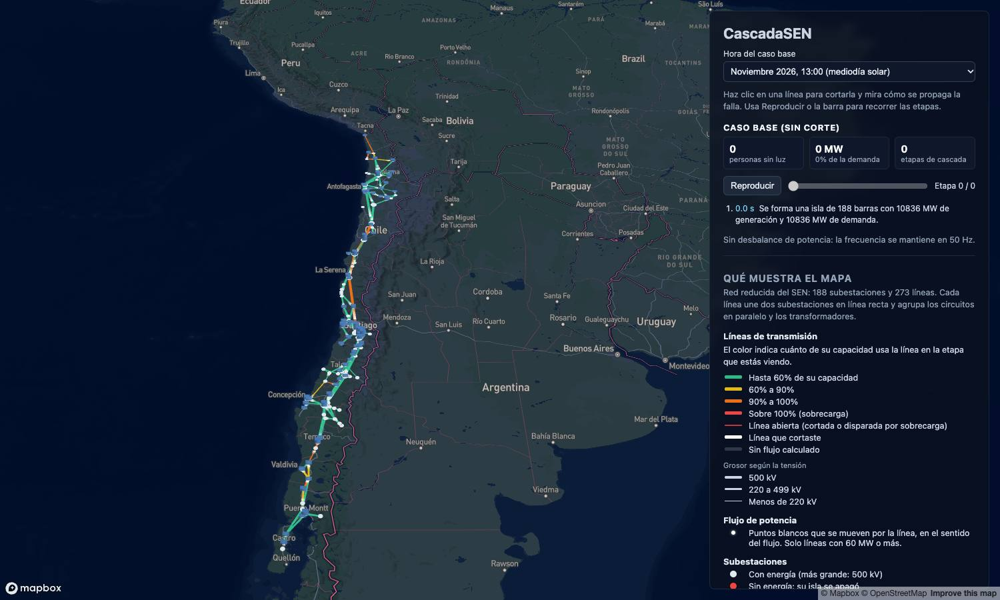
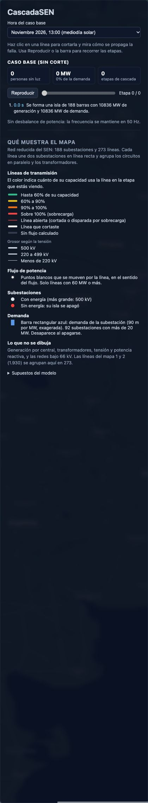

# Mapa 3: cascade viewer

Mapa 3 is the main map of the app (`/`, also `?mapa=3`). Mapas 1 and 2 (`?mapa=1`, `?mapa=2`) are deprecated and kept as reference. Mapa 3 shows what happens to Chile's SEN when you cut a transmission line. You click a line, the engine (`docs/engine.md`) computes the cascade, and the map replays it stage by stage: lines that overload and open, islands that form, substations that go dark, and the frequency of each island.

UI strings are Spanish. This document is English. Every claim is tagged EVIDENCE (read from code, data or engine output) or ASSUMPTION (a modelling choice, not verified against the real system).



## 1. Actors in the network

This is the reference list for future work. Each actor has: what it is in our data, what role it plays in the cascade, how the map draws it, and where it lives in the code. "Modelled" means the engine computes something with it.

### 1.1 Summary table

| # | Actor | Modelled | Role in the cascade | Drawn on the map |
|---|---|---|---|---|
| A1 | Substation (bus) | Yes | Node where generation, demand and lines meet. Becomes dark when its island collapses. | Circle. White = energised, red = dark, bigger = 500 kV |
| A2 | Transmission line | Yes | Carries power between two substations. Opens when it exceeds 120% of capacity, or when you cut it. | Line. Colour = loading, width = kV |
| A3 | Synchronous generator | Yes (aggregated per bus) | Supplies MW, supplies inertia (slows frequency change) and primary reserve. | Not drawn |
| A4 | Non-synchronous generator (solar, wind, CSP) | Yes (aggregated per bus) | Supplies MW, no inertia, no reserve. Is curtailed when frequency rises above 50.2 Hz. | Not drawn |
| A5 | Demand (load) | Yes | Consumes MW. Falls slightly with frequency. Is the thing that gets shed. People in the dark are computed from it. | Blue rectangular bar |
| A6 | Overload protection | Yes (simplified) | Opens the most overloaded line(s) each stage. | Line turns grey and thin ("open") |
| A7 | EDAC (under-frequency load shedding) | Yes | Disconnects demand in steps when island frequency falls. | Events list, frequency chart, shorter bars |
| A8 | Island | Yes (emergent) | A group of substations still connected to each other after cuts. Has its own frequency. Survives or blacks out as a whole. | Colour of its frequency curve in the chart |
| A9 | Attacker or fault (the user's double click or "Sacar de servicio") | Yes | Starts the cascade by opening a line, or every line of a substation ("Apagar esta subestación"), at t = 0. | Cut line drawn dashed gray ("fuera") |
| A10 | Transformer | Folded away | Not an actor in the engine. Its capacity is merged into the line. | Not drawn |
| A11 | HVDC link | No | Excluded. Kimal-Lo Aguirre is a 2029 build, so it is dropped for 2025 and 2026. | Not drawn |
| A12 | Storage (batteries, pumped hydro) | No | Not modelled as fast injection. | Not drawn |
| A13 | System operator (CEN) | No | No manual redispatch, no restoration. | Not drawn |
| A14 | Voltage and reactive power | No | DC flow only. The north's voltage collapse in the real 25F is not computed. | Not drawn |
| A15 | Distribution companies and customers below 66 kV | No | Only their aggregated demand at the substation. | Not drawn |

### 1.2 Detail per actor

**A1. Substation (bus).**
- Data: `NetNode` in `web/src/cascade/types.ts`: `id, name, lon, lat, kv, zone, map_nodes`. 188 in the 2025 and 2026 networks (EVIDENCE: `network-2025.json`).
- Rule: one bus per substation. The 1,930 lines and the transformer buses of the PyPSA-CL model collapse into it (`network.py`, `reduce_network`).
- Zone: `norte_grande` if latitude is north of -26.0, otherwise `centro_sur` (EVIDENCE: `NORTE_GRANDE_MAX_LAT`). The zone selects which EDAC table applies.
- State per operating point (`buses.json`): `gen_mw`, `load_mw`, `people`.
- Becomes dark when its island ends as `blackout`, `dark` or `local_cut`.

**A2. Transmission line.**
- Data: `NetLine`: `id` (for example `R239`), `a`, `b`, `kv`, `capacity_mw`, `x_pu`, `map_edges`, `branches`.
- 273 lines. Parallel circuits and transformers between the same two substations are merged: capacity is added, reactance is put in parallel. A click on a line cuts the whole merged corridor (for example the four 500 kV circuits Alto Jahuel-Ancoa).
- Reactances under 5e-4 pu are raised to 5e-4 pu (ASSUMPTION, keeps the solver well conditioned).
- Per stage state: `flow_mw`, `loading` (flow / capacity), `status` = `ok`, `overload` or `open`.
- Drawn as a straight segment between the two substations, not the real route.

**A3. Synchronous generator.** Hydro (reservoir and run-of-river), coal, gas, diesel, biofuel, geothermal.
- Role: gives MW, rotating inertia (`inertia_by_bus_mws`) and primary reserve.
- Primary reserve = 4% of the online synchronous MW of the island, full at 0.3 Hz deviation, time constant 3 s (ASSUMPTION, `frequency.py`).
- Inertia is what slows the frequency fall. An island with no synchronous machine cannot hold frequency and is lost (`no_inertia`).
- The engine holds one aggregated value per substation, not per plant. Plant-level detail exists in `operating_points.json`.

**A4. Non-synchronous generator.** Solar PV, onshore wind, CSP (EVIDENCE: `NON_SYNCHRONOUS` in `build_baseline_opf.py`).
- Role: gives MW. No inertia, no reserve.
- Over-frequency: reduced by 55% of its power per Hz above 50.2 Hz (NTSyCS, per `frequency.py`).
- Ride-through trips (inverters disconnecting on voltage or frequency dips) are not modelled. In the real 25F they mattered.
- This is why the hour matters (EVIDENCE: `baseline_opf.json`, MW by carrier):

| Point | Solar PV | Wind | Hydro (ror + reservoir) | Coal | Gas |
|---|---|---|---|---|---|
| feb2025-1500 | 5,944 | 1,447 | 2,818 | 94 | 423 |
| feb2025-0300 | 0 | 1,337 | 4,331 | 2,008 | 693 |
| nov2026-1300 | 7,706 | 1,606 | 1,300 | 60 | 2 |
| nov2026-2000 | 0 | 7,510 | 2,017 | 719 | 355 |

**A5. Demand.**
- Source: PyPSA-CL `Loads.xlsx`, mapped to the 188 substations. People come from the INE comunas served by each node.
- Frequency dependence: load changes 1.5 % per Hz (ASSUMPTION, range 1 to 2 %/Hz in `stack.md`).
- It is lost in two ways: shed by EDAC (a share of the zone's load), or lost with its island.
- Drawn as a rectangular bar of 90 m per MW (exaggerated), only for substations above 20 MW (92 of 188 at `nov2026-1300`).

**A6. Overload protection.**
- Each stage, the engine computes DC flows. If the worst line is above 120% of capacity, it opens every line at that worst ratio (ASSUMPTION: 120% threshold, 1.0 s between stages, up to 20 stages).
- Its parameters are in `Params` in `engine.py`. It is a simplification of real line protection (no time-current curves, no thermal inertia).
- N-1 is not imposed in the base case, so some lines start at 100% of capacity and any extra flow trips them.

**A7. EDAC.**
- Real steps taken from the CEN 25F report: centro-sur table (6 steps from 49.0 to 48.3 Hz, per zone, with a rate-of-change trigger on steps 1 and 3 at -0.6 Hz/s) and norte grande Tabla 3-9 (step 1 disabled).
- MW per step are interpolated between the low-demand and high-demand columns by system load (8.5 to 11.5 GW, ASSUMPTION) and then scaled to a share of the island's own zone load. A small island sheds less.
- Each step fires once.

**A8. Island.**
- Found by walking the lines that are not open (`flow.py`, `find_islands`).
- For each island the engine solves the swing equation `(2E/f0) df/dt = P_gen + P_reserve - P_curtailed - P_load(f)` for 20 s.
- Outcomes: `maintains` (frequency stays between 47.5 and 52 Hz), `blackout` (leaves that band), `dark` (no generation or no load), `local_cut` (no inertia and under 200 MW load).
- A balanced island (gap under 1 MW) is stable without simulating.

**A9. The cut.**
- Any line, one at a time in the UI. The engine accepts several ids (`run_cascade_workflow`).
- Real-world meaning: a physical attack, a fault, or a maintenance outage. The engine does not distinguish.

**A10 to A15. Not actors in this version.** See section 7. These are the first candidates to add, in this order of value: voltage collapse in the north (A14), ride-through trips (A4), storage (A12), HVDC (A11), N-1 base case, operator actions (A13).

### 1.3 Who acts at each moment of a cut

| Time | Actor that acts | What happens |
|---|---|---|
| 0.0 s | A9 cut | The line opens. |
| 0.0 s | A8 islands | The engine looks for islands. |
| 0.0 to 20 s | A3, A4, A5, A7 | In each island: inertia slows the fall, reserve and damping push back, EDAC sheds load by steps. Outcome: maintains or blackout. |
| 1.0 s, 2.0 s... | A6 protection | The most overloaded line opens. New islands may form. |
| End | A1 substations | Those in islands that collapsed become dark. People are added up from A5. |

## 2. Quick start

```bash
git pull
cd backend && PYTHONPATH=src python -m cascadasen.application.cache_builder   # or: uv run cascadasen-cache
cd ../web && npm install && npm run dev
```

The cache (about 46 MB, 4 hours x (273 line cuts + 188 substation shutdowns + `health.json`)) is committed, because the deployed web image has no Python. Regenerate it with `cascadasen-cache` and commit it whenever the engine or `data/processed` change. If a file is missing the page shows "Falta la caché (...)".

| URL | Opens |
|---|---|
| `http://localhost:5173/` | Base case, Nov 2026 13:00 (same as `?mapa=3`) |
| `/?mapa=3&point=feb2025-1500` | Pick the hour: `feb2025-1500`, `feb2025-0300`, `nov2026-1300`, `nov2026-2000` |
| `/?mapa=3&point=feb2025-1500&cut=R239` | The 25F corridor cut, already playing |
| `/?point=feb2025-1500&cut=R239&vista=3d` | The same, with the camera tilted |

The URL follows the app: choosing a point, cutting a line or switching to 3D rewrites `point`, `cut` and `vista`, so the address bar is always a deep link to the current view. It carries only values that differ from the defaults: a point other than `nov2026-1300`, a cut, and `vista=3d`. Other params (`sesion`, `mapa`, `limite`) are kept. A bare `/` is the default view, and an explicit `?point=nov2026-1300` is normalised to `/` (`web/src/cascade/url.ts`).

With `VITE_MAPBOX_TOKEN` in `web/.env.local` (git-ignored) the basemap is Mapbox. Without it, the offline Chile outline is used.

## 3. 2D and 3D views

The layers button (top right, above zoom) opens a small panel with **Vista 2D | 3D** and two layer switches. Both views use the same Mapbox Standard map (night, monochrome theme). 2D is the default and matches Design v5: the camera looks straight down and cannot be tilted or rotated. 3D tilts the camera 45 degrees. Open directly in 3D with `?vista=3d`. The map controls also have **Ver todo Chile**, which returns the camera to the initial fit. Escape or a click outside closes the layers panel. To the left of the layers button, on the same row, is **Prender todo** (section 4, item 9); the open layers panel covers it. The layer switches are **Flujo de potencia** (moving dots, on by default) and **Demanda por subestación** (off by default): cream discs whose area grows with MW in 2D, rectangular columns in 3D. There is also a layer for flat icons that is empty for now (`web/src/cascade/icons.ts`).

## 4. How to use it

Layout (Paper "Design v5", `docs/design.md` section 3.2, with the Design v6 rail and line colors of section 3.3): a 200 px nav rail, a 440 px panel docked next to it with four tabs, the timeline card under the panel, map controls at the top right, and the legend with the scale bar at the bottom right.

1. **Nav rail, Escenarios**: two folders. **Desastres** holds "Apagón 25F" (`R239` at `feb2025-1500`). The cuts the user makes are not scenarios: they go to the tab Estado de la red. **Benchmark** holds the operating conditions with no cut, other than the 25F's own point: "Demanda mínima", "Mediodía solar" and "Punta nocturna", each with its date. Clicking an entry opens it (Benchmark on the Red tab with line colour Tensión, Desastres on Simulación with Carga). A bare `/` opens Mediodía solar with Chile alone; the selected background marks the active one. A cut on another hour is made by picking a Benchmark condition and cutting a line on the map. If the cache has no timeline for that cut at the point, the app shows the base case and a note. If the tree does not fit, it scrolls and "Ayuda" stays at the bottom. Code: `web/src/cascade/Scenarios.tsx`; the names and date lines come from `conditionName` and `conditionDate` in `text.ts`. "Fuentes de la grilla" below it picks the networks that make up the grid (docs/grids.md).
2. **Nav rail, other items**: "Fuentes y supuestos" opens the sources and every engine assumption in the panel; "Ayuda" opens what the map draws (section 5). "Validación" is not built yet.
3. **Tab Red**: size of the whole IDE Energía grid (km of lines, substations, installed MW, km by voltage band). Line colour shows voltage.
4. **Select and cut.** A single click on a line or a substation selects it at once (white halo on a line, larger outlined dot on a substation) and its card opens at the top of the panel, in whichever tab is open; selecting never switches tabs or the line colour, and it leaves Ayuda or Fuentes. Clicking empty map or pressing Escape clears it. The line card shows voltage, the model branches folded into the corridor (not physical circuits), capacity, flow with its direction, loading and status at the current second (en servicio, sobrecargada, fuera de servicio, sin tensión; a line exactly at 100 % reads "al límite"), its two end substations (a click selects them) and the button **Sacar de servicio**. A **double click** on a line does the same as the button. The cut line's card and the impact card offer **Reponer línea**, which returns to the base case at the same point. A cut clears the selection and switches the panel to **Simulación** and line colour to load, so the impact card is at the top. The substation card shows kV, zone, generation, demand, people and its connected lines with their loading; a click on one of those lines selects it. Its button **Apagar esta subestación** (or a double click on the substation) takes it out of service with its demand and generation; it is one more change in Estado de la red, simulated together with the others through `POST /api/v1/grids/simulate` (docs/grids.md). In a session it opens that substation's lines instead (section 11). A link `?cut=sub-B012` opens with that substation out of service. While it is out, its card and the impact card offer **Encender subestación**. The cache still holds `<point>/sub-B###.json` (every line of that bus opened at t = 0, built by `cascadasen-cache`); the app no longer reads it. How clicks arrive on each basemap: `web/src/cascade/clicks.ts`.
5. **Tab Simulación**: people without supply and their share of the country, lost load, lost generation, the lowest island frequency (or "apagón"), and the numbered event history. When the cascade has played out and the engine found nobody without supply and no lost load, the card says "El sistema resiste este corte" instead of a large 0 (204 of the 273 cuts at `nov2026-1300`). Every figure is read at the current second of the timeline, so it grows as the cascade plays (section 5.1). A click on an event jumps to it. The "N supuestos en esta simulación" row opens the assumptions. Below the figures (issue #72, `health.md` "Cost"): the after-cut "índice de margen operativo" and the "costo estimado" in US$ (with a note when the voltage-collapse rule darkened islands), captioned "Al final de la simulación. Índice de margen operativo (modelo) y valoración regulatoria (costo de falla CNE), 4 h supuestas."; these two are end values, not animated with t. Without a cut, the "Escenario nuevo" card shows the pre-fault index and the N-1 money at risk (expected and worst) from `<point>/health.json`, hidden in a session or a composed grid. Each row hides when an old cache lacks its fields.
6. **Timeline card**: clock with tenths, the frequency of each island, speed (1x, 2x, 4x), play, pause or repeat, and the rail. The rail spans the whole timeline (`duration_s`, usually 20 to 29 s) with the numbered event markers at their true times; events whose markers would overlap share one ("1·2", "1–11"). The curves above the rail are the island frequencies on a fixed scale (y = 11 - 4 x (Hz - 50) in 22 px), drawn up to the current second; red means the island fell below 49 Hz. Drag the rail, click a marker, or use the arrow keys (Shift for 1 s steps), Home and End. The space bar plays or pauses when no form control or button has focus. With no cut the card says how to start one.
7. **Map pins and callout**: the same event numbers appear on the map where the event happens (the cut or tripped line, the centroid of the zone that sheds load, the centroid of the area that goes dark). The latest event with a place is red and has a callout with people without supply and lost load; the first event keeps a short label. Events without a place (an island forms, an island stabilises) appear only in the history and on the rail.
8. **Legend** (bottom right): "Color de líneas" switches between Tensión and Carga. The Tensión legend lists only the voltage tiers in the model network; the Carga legend always lists six items and dims the ones absent from the current frame.
9. **Tabs outside a session:** **Estado de la red** (first), **Red** and **Simulación**. "Qué lo habría evitado" and "Validación" are not built yet and are not shown, so the tabs fit the 440 px panel. **Estado de la red** starts with "Resultado de la caída" (people without power and % of the country, MW lost, generation lost, islands that went dark: the same figures Simulación shows at its last second, and the cost from `POST /api/v1/grids/cost`, pending until issue #82 is built). It lists every change the user made (lines cut and substations out of service), each with **Reponer**, and **Reponer todo**. A new cut or outage adds to the list, never replaces it. A double click on a substation takes it out of service like on a line (a shared session keeps its own edits in Datos). With no change or one line the app reads the precalculated timeline from `web/public/cache`; with more it calls `POST /api/v1/grids/simulate` and plays the timeline it returns (docs/grids.md). Code: `web/src/cascade/{edits.ts,NetworkState.tsx}`.
10. **Prender todo** (top right, left of the map controls): one step back to the full, energised network. It shows from every tab and from Ayuda, Fuentes and Sesión. It clears every cut, the selection and the notice, and puts the timeline at 0, paused. It clears the list in Estado de la red (lines and substations) and keeps the operating point, so the rail shows the Benchmark entry of that hour and the URL drops `cut`. The tab, the line colour and the 2D/3D view do not change. It is disabled ("No hay nada apagado ni editado.") while no change is in force; a selection or a timeline position alone does not enable it. Code: `web/src/cascade/powerAll.ts` (`canPowerAll`, `powerAll`). Session behaviour: section 11.

## 5. Legend (what the map draws)

| Element | Meaning |
|---|---|
| Line colour, Red tab | Voltage, in cold colors that get brighter with kV: 500 kV white, 154 to 345 kV light cyan, 100 to 110 kV blue, 44 to 69 kV deep blue, medium voltage gray |
| Line colour, Simulación tab | Loading at the current second, as a traffic light: under 50 % green, 50 to 75 % yellow, 75 to 100 % orange, over 100 % red and thicker. Red is always failure |
| Near-black line with a faint outline | "sin tensión": both ends are without supply |
| Dashed gray line | "fuera": cut by you or tripped by overload (over 120 %). Drawn above the live lines, so a cut line stays visible next to a parallel overloaded one |
| Line width | Always voltage: 500 kV, 154 to 345 kV, lower |
| Moving white dots | Direction of flow. Only lines with 60 MW or more |
| Substation dot | Light gray = with supply (larger: 500 kV), red with a dark outline = without supply |
| Cream disc or column | Demand of the substation (off by default) |
| Numbered pins | Events, the same numbers as the history and the timeline |

The map legend, the "Ayuda" view and the layers share the constants in `web/src/cascade/layers.ts` (`VOLTAGE_TIERS`, `LOAD_BANDS`, `DEAD_LINE`, `OPEN_LINE`, `FAULT`), so they cannot drift apart. The panel's "Líneas por tensión" card uses `VOLTAGE_BANDS` in `networkSummary.ts`, which takes its labels, kV limits and colors from `VOLTAGE_TIERS` and counts the whole IDE Energía grid rather than the 273-line model. The other countries' lines and substations (`web/src/map/regional.ts`) read the same `VOLTAGE_TIERS` and `NODE_COLOR`; in the load view their lines are neutral gray (`REGIONAL_NO_LOAD`) because they carry no load.

Not drawn: generation per plant, transformers, voltage and reactive power, networks below 66 kV, and the 1,930 original map lines of mapas 1 and 2.

### 5.1 Reading the cascade at second t

The cache stores one frame per network stage and events with their own times (`web/src/cascade/simulation.ts`):

- **Dark substations**: a frame's `dark` list is the state at the end of its stage, but an island only goes dark when its `island_blackout` event fires (in the 25F case 8 s after the stage starts), so new dark substations wait for that event.
- **People without supply and lost load**: dark substations count whole. Load shed in islands that survive is not stored per substation, so it is spread over time by the MW shed so far, and shed MW count at the system's people per MW before their island collapses. Both are capped by the engine summary, and from the last event on they equal it exactly (ASSUMPTION: the in-between values are an interpolation, not engine output).
- **Lost generation**: generation at dark substations. The engine has no generator trips.
- **Island frequency**: linear between the curve samples. An island whose curve stops at a blackout event shows "apagón".
- **Island names**: "Isla 1", "Isla 2" in the order the engine simulated them. The cache does not say which zone an island covers, so the app does not call them Norte or Centro-sur as the mockup does.

## 6. Worked example: the 25F corridor


EVIDENCE (engine output, `feb2025-1500`, cut `R239` Nueva Maitencillo-Nueva Pan de Azúcar 500 kV, 2,210 MVA; re-measured 2026-11-22):
- 1.0 s: Pan de Azúcar-Punta Colorada 220 kV passes 120% and opens.
- 2.0 s: Maitencillo-Pan de Azúcar 110 kV passes 120% and opens; the corridor separates into a centro-sur island (115 substations, 7,872 MW of load) and a north island (73 substations, 3,223 MW).
- The pre-fault flow across the corridor was 2,209 MW N→S, over the 1,600 MW limit of the defence scheme, so both islands collapse by voltage (a rule, `engine.md` 6).
- 16.8 million people without power, 11,096 of 11,096 MW (100%), 2 stages. The real 25F: about 19 M people (98.5%).
- Estado de la red lists the user's cut apart from these consequences (lines opened by overload and islands that went dark, with their second).

The same cut at `feb2025-0300` loses only 631 MW. Solar is off at night and coal and hydro run (EVIDENCE: carrier table above). ASSUMPTION: the corridor carries less and the system has more inertia, which explains the smaller loss. Do not present these numbers as a forecast.



## 7. Limits and assumptions

- DC flow: no voltage, no reactive power.
- Base case is secure for N-0 only. 10 to 21 lines start at their limit (N-1 is not imposed).
- Overload threshold 120%, 1.0 s per stage: ASSUMPTION, illustrative timing.
- Reserve 4% of online synchronous MW, damping 1.5 %/Hz, blackout under 47.5 Hz: ASSUMPTION except the 47.5 Hz limit (CEN 25F report).
- No ride-through trips, no batteries, no HVDC, no operator actions, no restoration.
- Storage in PyPSA-CL named `<TYPE>_<node>_<h>h` is expansion candidates, not real batteries.
- A cut takes out a whole merged corridor, not one circuit.
- Not calibrated against the 25F numbers beyond the one comparison above.
- The reduction (188 buses) contradicts the 10 to 14 aggregated nodes in `docs/stack.md`. The engine follows the reduction.

## 8. Data flow and files

```
data/scripts/*  ->  data/processed/{operating_points,baseline_opf}.json
backend cascade engine  ->  cache_builder  ->  web/public/cache/   (committed)
web/src/cascade/*  reads cache/*.json and draws it
```

| File | Role |
|---|---|
| `web/public/cache/index.json` | Points and assumptions |
| `web/public/cache/network-<year>.json` | The 188 substations and 273 lines |
| `web/public/cache/<point>/buses.json` | Generation, demand, people per substation |
| `web/public/cache/<point>/baseline.json` and `<line id>.json` | One timeline per cut: events, frames, frequency curves, summary |
| `web/public/cache/<point>/health.json` | Pre-fault health index and N-1 money at risk (`health.md` "Cost"); cut timelines also carry `health` and the cost in `summary` |
| `web/src/cascade/Scenarios.tsx` | Escenarios in the rail: Desastres (cuts) and Benchmark (operating conditions without a cut) |
| `web/src/cascade/CascadeApp.tsx` | Design v5 shell: state (selection, cut, point), animation loop (clock, layers, HTML overlays), keyboard, rail, panel, controls |
| `web/src/cascade/powerAll.ts` | Pure rules of **Prender todo**: when it is enabled (`canPowerAll`) and what it resets (`powerAll`) |
| `web/src/cascade/clicks.ts` | Pure click interpreter: single click selects, double click on a line cuts once on both basemaps |
| `web/src/cascade/SelectionCard.tsx` | Card of the selected line or substation, at the top of the panel |
| `web/src/cascade/simulation.ts` | Reads a timeline at second t: dark set, impact, island frequency, event markers and their map places |
| `web/src/cascade/layers.ts` | deck.gl layers and colour constants |
| `web/src/cascade/NetworkPanel.tsx`, `SimulationPanel.tsx` | Tabs Red and Simulación |
| `web/src/cascade/Timeline.tsx`, `MapLegend.tsx`, `MapOverlays.tsx` | Timeline card, map legend, event pins and callout |
| `web/src/cascade/Legend.tsx` | "Ayuda" and "Fuentes y supuestos" views |
| `web/src/cascade/text.ts` | Spanish narration of events, place names, number and clock formats |
| `web/src/cascade/cascade.css` | Styles of the shell (Design v5 tokens) |
| `web/src/map/shapes.ts` | Outline of the rectangular bars |

The frontend only reads files. All physics is in `backend/src/cascadasen/domain/cascade/`.

Regenerate data, in order (needs `openpyxl` and `scipy`, not in the repo dependencies; `build_operating_points.py` downloads PyPSA-CL files into git-ignored `data/raw/pypsa_cl/`):

```bash
python data/scripts/build_node_index.py
python data/scripts/build_operating_points.py
python data/scripts/build_baseline_opf.py
cd backend && PYTHONPATH=src python -m cascadasen.application.cache_builder
```

## 9. Troubleshooting

| Symptom | Cause and fix |
|---|---|
| Red note "Falta la caché ..." | The cache is missing. Run `cascadasen-cache`. |
| Offline outline instead of Mapbox | No `VITE_MAPBOX_TOKEN` in `web/.env.local`, or the token is invalid. Restart `npm run dev` after editing. |
| Blank map, console shows `deck: ... Assertion failed` | A `ColumnLayer` with custom `vertices` needs `diskResolution` equal to the vertex count (4). Fixed in `layers.ts`. |
| Click does nothing | You clicked off a line (the cursor turns into a pointer over anything clickable). Zoom in. Lines are thin. A single click only selects: the card opens at the top of the panel. To cut, double click the line or use "Sacar de servicio" in its card. |
| Double click zooms instead of cutting | It was on empty map, where double-click zoom stays (Mapbox, mouse). On a touch screen Mapbox double-tap zoom is off, and the offline map has no double-click zoom. |
| Never commit | `web/public/cache`, `.env*`, `data/raw` |

## 10. Glossary

- **SEN**: Sistema Eléctrico Nacional, Chile's main grid.
- **CEN**: Coordinador Eléctrico Nacional, the system operator.
- **EDAC**: Esquema de Desconexión Automática de Carga, automatic load shedding by frequency steps.
- **N-1**: the grid survives the loss of any single element. Not imposed here.
- **Island**: part of the grid that is electrically separated and has its own frequency.
- **Inertia**: energy in rotating machines (MW·s). More inertia, slower frequency change.
- **Primary reserve**: capacity that synchronous machines add automatically when frequency falls.
- **Ride-through**: ability of a plant to stay connected during a short disturbance. Not modelled.
- **25F**: the 25 February 2025 national blackout.

## 10. Operation mode: the strategic theatre on this map (backend contract)

The strategic theatre (`docs/strategy.md`) now runs on the same network and engine as this map. A run lasts 24-36 cycles of 5 minutes. In each cycle, digital degradation (telemetry loss, delayed or unreliable data, communications loss, false alarms), an adaptive adversary acting by area, unplanned external events, and the defenders' decisions and field crews play out. A physical event runs the same cascade engine as a line cut here. This section is the contract for the frontend. **Backend only for now:** the API, the snapshots and the offline cache are done; the visual layer of mapa 3 is not part of this PR and is left to the frontend work. A user flow that fits it: pick hour, scenario, defence policy and adversary; play 5-minute cycles drawing `grid`, areas and crews; replay `transient` in seconds; click a line or substation to inject an event (`POST /events`, applied next cycle); end with the report, the after-action and a replay with another policy (`/replay` + `GET /snapshots`).

**Sources.**
- Live: the API under `/api/v1/sim/*` (`docs/stack.md` 7.1). Every run without `seed` is a different random run.
- Offline fallback: `web/public/cache/theater/`, written by `uv run cascadasen-sim-fixtures` (git-ignored, like the cut cache).

**Areas.** The 13 operating areas `A01`-`A13` are groups of the 188 buses by latitude band. Corridors (`A06-A07`) are the `R###` lines that cross between two areas. Defence functions are `edac:norte_grande` and `edac:centro_sur`. The adversary acts only on areas, zones or defence functions, never on a single bus or line (`cyber.md` 8.7).

**Types**, reusing `web/src/cascade/types.ts`:

```ts
interface TheaterNetwork extends Network {          // GET /sim/network?point=  |  cache/theater/network-<point>.json
  point: string; points: string[];
  nodes: (NetNode & { area: string })[];
  lines: (NetLine & { corridor: string | null })[];
  buses: Record<string, BusState>;
  areas: { id: string; name: string; zone: string; lat: number; lon: number; population: number; buses: string[]; anchor_bus: string }[];
  corridors: { id: string; a: string; b: string; lines: string[] }[];
  defenses: Record<string, string[]>;                 // edac:<zone> -> areas
}
interface TheaterSnapshot {                         // one per 5-min cycle: POST /sim/runs/{id}/step  |  cache run file .snapshots[]
  cycle: number; t_min: number;
  events: { effect: string; type: string; target: string; area: string | null; source: "scenario" | "user" | "adversary" | "external"; cause: string; status: string }[];
  grid: Frame & { buses: Record<string, number> };  // quasi-steady state at the end of the cycle; draw it with layers.ts
  transient: Timeline | null;                       // the cascade (seconds) when a physical event happened this cycle
  areas: Record<string, { observability: number; posture: "normal" | "manual" | "segmented"; effects: { id: string; type: string; source: string }[] }>;
  crews: { id: string; base: string; position: string; bus: string; lon: number; lat: number; task: string | null; target: string | null; target_bus: string | null; arrival: number | null; status: "free" | "busy" }[];
  observed: unknown; estimated: unknown; decisions: unknown[]; executed: unknown[]; metrics: unknown;   // panels
  llm: { status: "chosen" | "unavailable" | "idle" | "replayed"; model: string | null; chosen?: string[]; explanation?: string } | null;  // C2 with an LLM, when the run has llm_commander
}
```

**How the two clocks fit.** The operation mode belongs in the main map (`/`). The player moves cycle by cycle (5 min) and draws `grid` with the existing layers: `buildCascadeLayers({ network, buses, frame: snapshot.grid, time, selected, mode })`, with the same `mode` (`"2d" | "3d"`, `?vista=2d`) as the cut viewer. In 2D the demand is drawn as discs, in 3D as columns; `snapshot.grid.buses` gives the served MW per bus to scale them. When `transient` is not null, the viewer can replay that cascade inside the cycle with the same code as a cut (`frames`, `events`, `frequency_hz`). An area overlay can colour areas by `observability` and `posture`. Crews are drawn at `lon`/`lat` and move toward `target_bus` until `arrival`.

**Other endpoints the frontend needs:** `GET /sim/runs/{id}/snapshots?start=` (snapshots already computed, e.g. after `/replay`, which runs all its cycles at once) and `GET /sim/catalog` → `llm: {available, model}` (whether the server has an LLM commander configured).

**Offline index** (`cache/theater/index.json`): `{points, runs: [{file, point, template, policy, seed, adversary}], notice}`. Each run file holds `{run, recipe, snapshots, report, after_action, trace_head}`.

Never shown: the adversary's learned weights or any ranking of areas or elements. Every run carries the notice "Escenario hipotético: se modela el efecto, no el ataque."

## 11. Session mode: a shared, editable copy of the network
Without a session, mapa 3 reads only the static cache (`web/public/cache/`) and makes no `/api` request, so it works with no backend. With a session it reads the sessions API (`docs/sessions-api.md`) through `/api`, which the Vite dev server proxies to the backend (`VITE_API_TARGET`, default `http://localhost:8000`; docker compose sets `http://backend:8000`). In production CloudFront and the ALB already route `/api/*` to the backend (`docs/infrastructure.md`), but until the sessions bucket and task role are applied the deployed backend keeps sessions in memory (`CASCADASEN_SESSION_STORE` defaults to `memory`), so they are lost on every restart or deploy. Test session mode on the local stack until then.

**Sources.**
| Mode | Network and buses | Timeline | Point |
|---|---|---|---|
| No session (`/`) | `cache/network-<year>.json`, `cache/<point>/buses.json` | `cache/<point>/<cut>.json` | Time pill |
| Session (`/?sesion=<sid>`) | `GET /api/v1/sessions/{sid}/network` | `GET /api/v1/sessions/{sid}/state` (the shared sandbox cut) | Pinned by the session; the conditions in the rail tree are disabled |

**Entering and sharing.** Without a session the only visible addition to the Design v5 shell is the rail item **Sesión compartida** (above Ayuda). It opens a panel view with **Crear sesión** (`POST /sessions`) and **Unirse** (paste the id or the link, then **Unirse** or **Cancelar**); creating or joining from there opens the **Datos** tab. In a session the same view shows the id, **Copiar enlace** (`<origin>/?sesion=<sid>`) and **Salir**, and the panel head shows a session strip under the crumbs: `Sesión <first 6 chars>`, the revision (`rev. N`), the live mode and **Copiar enlace** (**Copiado** for 1.5 s). The live mode is **en vivo** (SSE stream `GET /{sid}/events`) or **sondeo** (no `EventSource`, or the stream gave up: `GET /{sid}` every 2 s with `If-None-Match`). The id lives only in the URL (`?sesion=`), so a bare `/` never rejoins a session or calls `/api`; **Salir** removes it. A session that no longer exists (404) is forgotten and the map falls back to the cache. When the `dataset_revision` changes the page refetches the session, the network and the state; run activity (`run_created`, `run_updated`) refetches only the session document. When refetches overlap (`web/src/session/loader.ts`), the network and state of the newest full refetch are always applied, and a session document only when no newer document read started, so a run event during a dataset refresh no longer drops the new network.

**Cuts in a session.** A double click on a line, or **Sacar de servicio** in its selection card, calls `POST /{sid}/cut` with that line: it opens for everyone in the session and stays open until someone repairs it. **Reponer línea** in the selection card of an open line repairs that line; **Reponer línea**/**Reponer líneas** in the impact card repairs every open line (`{all: true}`). **Simulación** starts with the card **Líneas abiertas en la sesión · N**, which lists the open lines with **Reparar** (`POST /{sid}/repair {lines}`) and **Reparar todo** (`{all: true}`) and shows the notice the API returns; the impact card names every open line after `Corte:`. The session pins the operating point and owns the cut, so the Escenarios tree in the rail is locked (`ScenarioTree` with `locked`): the folders only fold and unfold, and every entry except the active one is disabled with the tooltip "En una sesión el punto está fijo; corta y repara líneas en el mapa y en Simulación.". The active entry is "Apagón 25F" when `R239` is the only open line, otherwise the Benchmark condition of the session's point. The URL keeps `?sesion=` (and `vista`) and drops `point` and `cut`. **Apagar esta subestación** in a session sends that substation's lines that are still closed in one `POST /{sid}/cut`; the session then holds them as ordinary open lines (there is no `sub-` id in a session). The card reads **Encender subestación** while all its lines are open, and it repairs exactly those lines. **Prender todo** (section 4, item 9) asks "¿Prender toda la red? Repara todas las líneas abiertas para todos los participantes de la sesión." and, on OK, repairs every open line (`POST /{sid}/repair {all: true}`) and clears the selection and the timeline. Session dataset edits stay; **Restablecer** in Datos is what drops them.

**Tabs in a session:** **Red**, **Simulación** and **Datos**. The two placeholder tabs (Qué lo habría evitado, Validación) are hidden in a session so the three tabs fit the 440 px panel; without a session the tabs are main's four and there is no Datos tab.

**Tab Datos** (only in a session): the session's copy of the network. Until the network arrives it shows "Cargando la sesión…".
- Header: the session's base case without cuts (`baseline`: highest line loading, overloaded lines, MW shed), each redispatch (`balance`) and every warning. **Restablecer** (`POST /{sid}/reset`) drops all session edits after a confirmation.
- Sub-tabs **Barras**, **Líneas**, **Generadores** and **Cargas y datacenters**: add forms, a list with an origin tag (`base` or `sesión`) and the label **supuesto (sesión)** on every session or overridden value, and per element a form that sends only the changed fields (`PATCH`), **Fuera de servicio** / **Poner en servicio** (`in_service`) and **Borrar** for session elements (base elements cannot be deleted).
- **Elegir en el mapa** turns the next map click into the latitude and longitude of the form. For a load or datacenter, **Conectar a la subestación ≥220 kV más cercana** picks the nearest in-service bus of 220 kV or more (`web/src/session/geo.ts`, great-circle distance). That is the only geometry the browser computes; balance and cascades come from the API.
- Edits send `If-Match` with the `dataset_revision` on screen. If another client changed the dataset first (412), the page reloads and asks you to retry. Run activity by other clients does not cause a 412. Every session request that gets the busy 409 (`sessions-api.md` section 7) waits `Retry-After` and is retried up to 2 times. Once the write is accepted the edit counts as done (the form closes) even if the reload after it still fails; the page then shows that reload error and keeps the network on screen until the next revision event reloads it. A busy 409 on the first load keeps the session and retries the load every 3 s; network errors and 5xx fall back to the base case. Overlay warnings in **Datos** use a neutral note, because red is reserved for faults.

**Files.** `web/src/session/sessionApi.ts` (typed calls for every session route, `ApiError`, `sessionIdFrom`, `subscribe`), `useSession.ts` (state and refetch), `loader.ts` (which refetch result is applied), `SessionBar.tsx` (the view card and the compact strip), `SessionCut.tsx` (open lines in Simulación), `DataPanel.tsx`, `geo.ts`, and `session.css` (session styles under `.shell`: radius 0, cascade.css tokens, `.tag` for labels because `.shell .badge` is the event marker). `CascadeApp.tsx` wires them into the shell.
